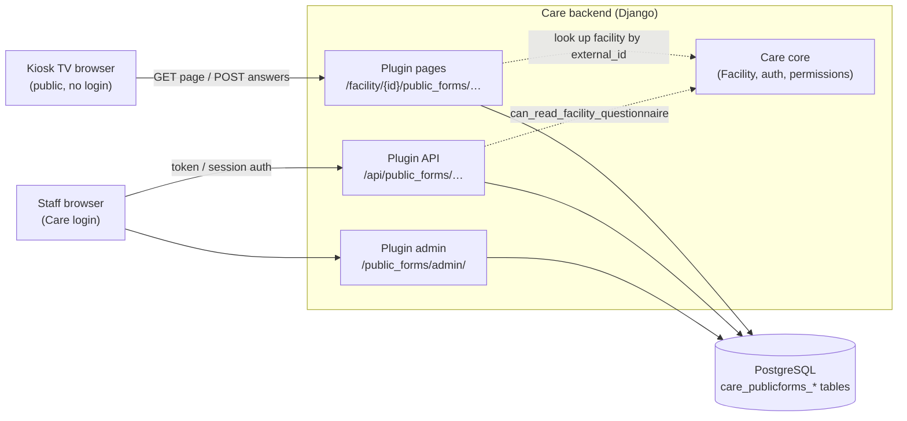
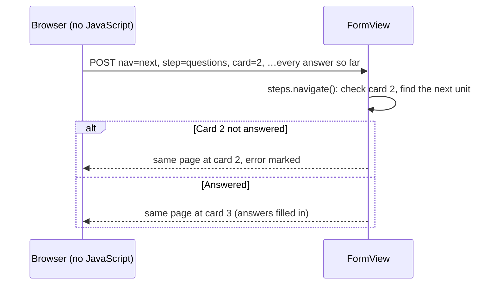
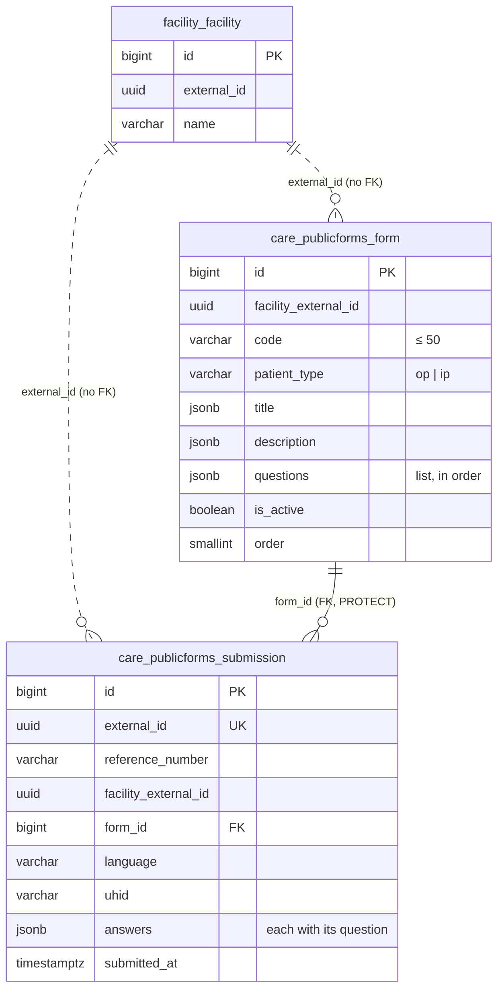

# Public forms plugin: architecture and database

This document describes how the `care_publicforms` plugin is built and
how it stores data. It is for developers and people running Care. For
installing, configuring and using the plugin, see the [README](../README.md).

- [1. Overview](#1-overview)
- [2. How the plugin fits into Care](#2-how-the-plugin-fits-into-care)
- [3. Code layout](#3-code-layout)
- [4. Pages, URLs and the request flow](#4-pages-urls-and-the-request-flow)
- [5. The page in the browser (kiosk.js)](#5-the-page-in-the-browser-kioskjs)
- [6. Languages](#6-languages)
- [7. Validation and saving](#7-validation-and-saving)
- [8. Database](#8-database)
- [9. Staff API and admin](#9-staff-api-and-admin)
- [10. Settings](#10-settings)
- [11. Security and privacy](#11-security-and-privacy)
- [12. Testing](#12-testing)
- [13. Extending the plugin](#13-extending-the-plugin)
- [14. Known limitations](#14-known-limitations)

---

## 1. Overview

The plugin collects patient satisfaction feedback (the NQAS OPD and inpatient
formats) on touch-screen TV kiosks in a hospital. Its design follows from
where it runs:

| Constraint | Design decision |
| --- | --- |
| TV and signage browsers are old and slow | Server-rendered Django templates; plain ES5 JavaScript; no build step; no flex `gap`, `clamp()`, `aspect-ratio`, `inset` or `oklch()` colours |
| Anyone in the hospital may use a kiosk | Public pages: no login, kiosk key, session or cookie |
| Kiosks are shared by one patient after another | Nothing is stored until submit; idle reset; the next patient always starts in the screen's own language |
| Forms change per hospital | Forms live in the database, each with its questions as one JSON list, edited in the plugin's own admin (`/public_forms/admin/`, apart from Django's `/admin/`) |
| Reports must survive changes elsewhere in Care | Two tables; the only relation is submission → form, **nothing links to Care** (facilities are kept by id); each answer is saved with its question as asked |
| Patients speak different languages | Every string is in the page in each offered language; switching is instant |

A visit has these steps; the whole questionnaire is **one page** and is
**posted once**:

```
chooser (OP or IP)  →  identify (QR scan · type UHID · guest)  →  details
  →  ratings, one card at a time  →  open questions  →  review  →  POST  →  thank you
```

## 2. How the plugin fits into Care



How it is wired in:

1. **Installed as a Care plug.** Care's `plug_config.py` lists the plug;
   Care's plug manager `pip install`s it and adds the `public_forms`
   Django app to `INSTALLED_APPS`. Settings come from the plug's
   `configs={}` (see [§10](#10-settings)).
2. **API routes.** Care mounts every plug's `urls.py` under
   `/api/<plug name>/`, so `public_forms/urls.py` serves
   `/api/public_forms/…`.
3. **Page routes.** The pages are HTML, not API, so they live outside
   `/api/`. `PublicFormsConfig.ready()` (`apps.py`) appends
   `facility/<uuid:facility_id>/public_forms/` → `public_forms.pages` to Care's root
   URLconf. It also imports `checks.py`, which registers the settings checks.
4. **Static files.** `kiosk.css` and `kiosk.js` are collected by Care's
   `collectstatic`.
5. **care_fe is not involved.** Kiosks talk to the backend directly. If
   care_fe and the backend share a domain, the proxy must send the plugin's
   page paths to the backend (README → *Putting a form on a screen*).

The plugin reads one Care model, `facility.Facility` (by `external_id`), and
calls one Care permission, `can_read_facility_questionnaire`. The admin also
reads Care's role tables to limit each user to their facilities
(`access.py`). It has **no
database relations** to Care: no foreign keys, and its migrations don't depend
on Care's.

## 3. Code layout

```
src/public_forms/
├── apps.py              App config: mounts the page URLs, registers checks
├── pages.py             Page URLs (under /facility/<id>/)
├── views.py             FeedbackPage base + StartView, FormView, DoneView
├── questions.py         The pages JSON: fields and defaults (PAGE_FIELDS, FIELDS), Page, Question, parse_pages(), page_errors()
├── questionnaire.py     Form lookup, FormSpec (screens from the pages), answer parsing, question_order()
├── services.py          UHID format, collect_answers() / stored_answer(), create_submission(), reference numbers
├── patients.py          A patient's UHID from the patient id in a QR code (their "UHID" identifier)
├── steps.py             Step navigation on the server (no JavaScript); review rows
├── models.py            FeedbackForm (with pages JSON), FeedbackSubmission
├── i18n.py              Loads locale files (plugin's + LOCALE_DIRS): languages(), translate(), localize()
├── locale/              Screen text, one JSON file per language: <code>.json
├── templatetags/
│   └── public_forms_tags.py   , , , 
├── templates/public_forms/
│   ├── base.html        Page shell: header, language toggle, progress, footer, idle overlay
│   ├── choose.html      Form chooser
│   ├── form.html        The questionnaire form; includes steps/*
│   ├── steps/           identify, scan, uhid, screen (one per page of questions), ratings (the cards), review
│   ├── done.html        Thank you + reference number
│   ├── empty.html       Unknown facility / no active forms (404)
│   └── _face.html       Rating face icons
├── static/public_forms/
│   ├── kiosk.css        The OPD feedback design in Care's colours (DM Sans), single column scaled by rem
│   └── kiosk.js         Step machine and kiosk behaviour (ES5, no dependencies)
├── admin.py             Admin for forms (per-language boxes, pages JSON) and submissions (read-only, CSV)
├── admin_site.py        The plugin's own admin site at ADMIN_URL: who can sign in, sign-in limit
├── access.py            Which facilities an admin user reaches, by their Care roles
├── text_rules.py        Blocked characters and length limits for all typed text
├── api.py, urls.py      Staff API: responses list and per-form summary
├── settings.py          Plugin settings (PLUGIN_CONFIGS → env → defaults)
├── checks.py            `manage.py check` warnings for LANGUAGES / DEFAULT_LANGUAGE
├── seed.py              Default OPD and IPD forms, given to a facility by a command
├── management/commands/seed_feedback_forms.py
├── migrations/          0001 schema (two tables), 0002–0006 changes (below), then one per added language
└── tests/               Django tests
e2e/                     Playwright browser tests
```

## 4. Pages, URLs and the request flow

### 4.1 Routes

| URL | View | Methods | What it does |
| --- | --- | --- | --- |
| `/facility/<facility_id>/public_forms/` | `StartView` | GET | Form chooser; redirects to the form when only one is active |
| `/facility/<facility_id>/public_forms/type/<form>/form/` | `FormView` | GET, POST | The whole questionnaire; POST validates and saves |
| `/facility/<facility_id>/public_forms/type/<form>/done/` | `DoneView` | GET | Thank you and reference number |
| `/facility/<facility_id>/public_forms/patient/` | `PatientLookupView` | POST | `patient` (a QR's text) → `{"uhid": "…"}`; 404 `{"uhid": null}` when the facility has no UHID for it; 429 over `QR_LOOKUP_RATE_LIMIT` |
| `/api/public_forms/health` | `health` | GET | `OK` |
| `/api/public_forms/facility/<facility_id>/responses/` | `FacilityFeedbackListView` | GET | Submissions (staff) |
| `/api/public_forms/facility/<facility_id>/summary/` | `FacilityFeedbackSummaryView` | GET | Per-form summary (staff) |

`<facility_id>` is the facility's `external_id` (UUID); `<form>` is a
`FeedbackForm.code`. Every page view inherits `FeedbackPage.dispatch()`, which:

1. looks up the facility (unknown → `empty.html`, 404);
2. loads the facility's active forms with `forms_for_facility()` (none → 404);
3. reads the screen options and the patient's language from the query;
4. resolves `<form>` (unknown → redirect to the chooser).

### 4.2 Query parameters

Two kinds of state travel in the URL, because there is no session:

| Parameter | Kind | Set by | Kept on |
| --- | --- | --- | --- |
| `lang=kn` | Screen option: the screen's starting language | Whoever sets up the kiosk | Every URL the plugin builds, including idle reset |
| `scan=camera\|scanner\|off` | Screen option: QR reading | Kiosk set-up | Every URL |
| `keypad=0\|1` | Screen option: on-screen UHID keypad | Kiosk set-up | Every URL |
| `from=start` | The patient picked the form on the chooser | Chooser links | Links within the visit; decides whether Home and the end of the visit go to the chooser or to the form |
| `language=kn` | The patient's own language choice | Language toggle (kiosk.js rewrites links) | Links within the visit (form choice, Back, Home, Reset) and the thank-you page; **not** idle reset or the thank-you page's return |
| `ref=OPD-…` | Reference to show on the thank-you page | Redirect after POST | Thank-you page only |

### 4.3 One visit, end to end

```mermaid
sequenceDiagram
    autonumber
    participant K as Kiosk browser (kiosk.js)
    participant V as Views
    participant DB as PostgreSQL

    K->>V: GET /facility/{id}/public_forms/?lang=en
    V->>DB: Facility by external_id, active forms
    V-->>K: choose.html (all languages)
    Note over K: Patient switches to Kannada,<br/>links get language=kn
    K->>V: GET …/public_forms/type/opd/form/?lang=en&from=start&language=kn
    V->>DB: Form + active questions (FormSpec)
    V-->>K: form.html: every step, every language
    Note over K: Steps switch in the browser.<br/>Form controls are the only state.
    K->>V: POST same URL (uhid, language, from, question keys…)
    V->>V: rate limit, parse UHID, collect_answers()
    alt Problems
        V-->>K: 200 (or 429) form.html with answers kept,<br/>errors marked, opened at the first problem
    else Valid
        V->>DB: INSERT care_publicforms_submission (retry on reference collision)
        V-->>K: 302 …/done/?lang=en&ref=OPD-20261119-4821&from=start&language=kn
        K->>V: GET done
        V->>DB: reference for this facility + form, submitted in the last 20 s?
        V-->>K: done.html in Kannada; back to the chooser (English) after 20 s
    end
```

### 4.4 Without JavaScript: the same steps, one page each

The kiosk goes step by step without JavaScript too, still with no session:

- **The page always holds every step.** CSS shows only the step marked
  `is-active` (and the active rating card). The server marks it, so the page
  shows one step whether or not `kiosk.js` runs.
- **Every step button is a submit button** with `name="nav"` (`go:uhid`,
  `guest`, `uhid`, `next`, `back`, `edit:<key>`, `lang:<code>`, `submit`).
  With JavaScript, `kiosk.js` intercepts them and moves in the page; only
  `submit` posts. Without it, the button posts the form.
- **Answers travel in the form.** Inputs in hidden steps are still posted,
  so each POST carries every answer so far, plus where the patient is:
  hidden `step`, `card` and `return` (editing from the review).
- **`steps.navigate()`** (in `steps.py`, mirroring `kiosk.js`) works out the
  step that button leads to, checks the step being left (required answers,
  UHID length, dates), and the view renders the page at that step with the
  answers filled in and errors marked. Nothing is saved until `submit`, and
  moving between steps is not rate-limited.
- **Enter** (a keyboard, or a USB scanner typing into the UHID field) presses
  the form's first submit button: a hidden `nav=default` button placed at
  the top of `<body>`, before the header's language buttons (which also
  belong to the form via `form="feedback"`). `default` means "continue" on
  the UHID step and "next" on question steps.
- **Language** buttons post the form (`lang:<code>`), so switching keeps the
  step and the answers. On the chooser and thank-you pages they are links.
- **The review** is rendered by the server (`steps.review_rows()`); each row
  is a submit button `edit:<key>`. With JavaScript, `kiosk.js` rebuilds it.
- **Home and Reset** are buttons that post the form (`ask:home`,
  `ask:reset`); the server shows the same place with the card open
  (`Place.asking`). Its "No, keep my answers" posts `stay`; its "Yes" is the
  home link, or `reset`, which clears what Reset clears with JavaScript
  (`steps.reset_questions()`) and goes to the first rating. With nothing to
  lose, Home goes and Reset resets without asking.
- **What needs JavaScript:** the camera, the on-screen keypad (a plain field
  instead), auto-advance on ratings (tap an answer, then Next) and the idle
  warning. An idle step still starts over: a `<noscript>` meta refresh sends
  the page home `NO_JS_IDLE_TIMEOUT_SECONDS` after it loads, once it holds a
  patient's choices. The header counts down the last minute (m:ss, by CSS
  alone: the timer takes no room until then, and turns red for the last 30
  seconds; `views.no_js_countdown` sets the delays). The chooser and the
  identify page show no countdown while nothing is entered there
  (`idle_countdown`): they look like the home screen, and starting over only
  returns them to the screen's own form and language.
- **Back** after the page starts over (or after Home) reaches a posted page,
  which the browser won't show from its cache (`no-store`): it shows its
  "Confirm form resubmission" page, not the previous patient's answers.



## 5. The page in the browser (kiosk.js)

`kiosk.js` is progressive enhancement over the server-rendered form. It holds
no data of its own: the **form controls are the state**, and the page is
posted once from the review. It follows the same steps as the server-side
navigation in `steps.py` (§4.4); a change to one belongs in the other.

### 5.1 Steps

```mermaid
stateDiagram-v2
    [*] --> identify
    identify --> scan: Scan QR
    identify --> uhid: Enter UHID
    scan --> uhid: Type instead
    identify --> steps: Guest (or a scanner read a UHID)
    scan --> steps: QR read
    uhid --> steps: Continue (11 digits) / Guest
    state steps {
        [*] --> page1
        page1 --> page2: all required answered
        page2 --> pageN: …in the pages' order
        note right of page2: a page of ratings is a card per rating\n(tap a face: auto-advance 300 ms);\nany other page is one screen
    }
    steps --> review
    review --> steps: tap a row (then back to review)
    review --> uhid: change UHID (then back to review)
    review --> [*]: Submit (POST)
```

- **Units.** After identification the path is a list of *units* in page
  order: `screen-<n>` for page n of choice / date / text questions with a
  visible question, one unit per visible rating card (`questions`, by its
  index in `FormSpec.ratings`), then `review`. `flow()` sorts them by
  `data-order` (the page's number), so their order in the HTML doesn't matter. Back,
  Next and the progress bar walk this list (`flow()`, `position()`);
  `steps.flow_units` is the same list on the server.
- **Audience.** Questions are marked `data-audience="all|guest|identified"`.
  `applyAudience()` hides and **disables** the ones that don't apply, so they
  are not posted, and renumbers the cards ("Question 3 of 10").
- **Ratings** auto-advance only when tapped (pointer within 1.5 s); arrow
  keys just change the answer, so TV-remote users aren't rushed. Enter (a
  remote's OK) picks the focused answer.
- **Review** is built from the page: each visible question's short label and
  the visible text of its answer. Tapping a row edits that question; the next
  step returns to the review, via anything that still needs an answer
  (`returnTo`, `toward()`). That step shows no Back (`is-editing`).
- **Changing identity** (the UHID strip, or Back to the first step) from a
  question or the review keeps every answer and returns to that place
  afterwards, stopping first at questions that became required, e.g. age
  and sex after switching to guest (`resumeAt`, `toward()`). A place no
  longer asked becomes the next one. Without JavaScript the hidden `return`
  field carries the place (`"review"`, `"questions:4"`; `steps.toward`).
- **Home** is a link (drops everything). **Reset** clears the ratings and open
  answers in place and returns to question 1, keeping the UHID and details.
  Both show from the first rating question on, and ask first (`askFirst()`,
  the `#confirmHome` / `#confirmReset` cards in form.html) once they would
  clear something; without JavaScript the server opens the same cards
  (§4.4). The cards are in the page, under the idle warning, so the idle
  reset still works while one is open.
- **Checks before moving on:** required answers, UHID length, dates not after
  `max` (today). The server checks everything again.
- **Submit guard:** only from the review, once; Enter never submits.

### 5.2 Kiosk behaviour

| Behaviour | How |
| --- | --- |
| Idle reset | After `IDLE_TIMEOUT_SECONDS` (90) without input, `location.replace(home)`; warns in the last `min(15, timeout/3)` s. Armed on load when the page holds a patient's choices (`data-idle-armed`: their form, language, or answers after a failed submit), otherwise on the first touch. An untouched screen never reloads. |
| Keyboard-mode QR scanners | On the identify, scan and UHID steps, keystrokes less than 80 ms apart are buffered (heard first, in the capture phase, so a scanned code's Enter doesn't also reach the UHID box); Enter/Tab with a patient id or ≥ 6 digits, or a pause after a patient id or `UHID_LENGTH` digits, counts as a scan. A code with a patient id (a UUID) is looked up (below); otherwise the UHID is the digits of the payload (`UHID:123-4567-8901` works). |
| Patient QR codes | A code holding the patient's id in Care is POSTed to `…/public_forms/patient/` (`lookUpUhid()`); the UHID that comes back identifies the patient as if typed. No UHID (none recorded, in another format, a lookup refused or failed): "We couldn't read a UHID from that code" on the scan step, or on the UHID step when there is no camera, and the camera doesn't read that same code again. Without JavaScript a scanner types the id into the UHID box, and the server looks it up when the step is posted (`FormView.uhid_from_qr`). |
| Camera QR | `BarcodeDetector` on a `getUserMedia` stream, polled every 350 ms; a code with a patient id or `UHID_LENGTH` digits counts; stopped when leaving the step or hiding the page. The scan option is hidden while scanning can't work: no `BarcodeDetector` (or no `qr_code` format), no camera (`enumerateDevices`, rechecked on `devicechange`), or camera permission `denied` (`permissions.query`, rechecked on change). If opening the camera fails, the option is hidden and the patient goes to the UHID step. |
| Language | Sets `html[data-lang]`, swaps `data-l10n-*` attributes, updates the hidden `language` field and rewrites `a[data-carry-lang]` links with `?language=`. |
| Layout | One centred column; the root font size follows the viewport (`1.66vh` on TVs, `3.125vw` on tall portrait screens, 16 px on phones), so the same layout scales instead of re-flowing. |
| Down arrow | A screen taller than the window shows a round down arrow (`#scrollDown`) above the pinned main button, at the column's left edge in line with Back, while more than two lines' worth is below it; a tap scrolls to the bottom (smoothly, unless reduced motion is asked for). It hides while a text box has the focus, and without JavaScript (it can't know the screen scrolls). Rechecked on scroll, resize, step changes and after any click or input. |
| Text boxes | One line before the ratings and for a "Why?", two after them (`rows`); `fitTextBox()` grows a box with what is typed, up to eight lines, then it scrolls. Without JavaScript they keep their rows and scroll. |

## 6. Languages

- **What exists:** one JSON file per language, `locale/<code>.json`: the
  language's name, toggle label, Google Fonts family and `tall_script` flag,
  its screen strings and its default rating labels (format in `i18n.py` and
  the README). Folders in the `LOCALE_DIRS` setting are read after the
  plugin's own and merged over it, so a deployment can add a language or
  correct strings without a plugin change. Files are read once and cached
  (restart after editing). Question text is stored per language in the
  database.
- **What is offered:** the `LANGUAGES` setting picks and orders known
  languages; `languages()` returns them (cached per setting value).
  `BASE_LANGUAGE` (English) is required in the admin and is the fallback for
  any missing text.
- **Fonts and scripts:** `base.html` generates each offered language's CSS
  from its file: the font for `html[lang]` and every `[lang]` element (so a
  toggle button or hidden span is drawn in its own script), and, for a
  `tall_script` language, no uppercase on small labels and more line height
  on headings. There are no per-language rules in `kiosk.css`.
- **Rendering:** template tags render every offered language at once:
  `` and `` output
  `<span class="l10n l10n--en" lang="en">…</span><span class="l10n l10n--kn" lang="kn">…</span>`;
  a `<style>` in `base.html` shows the spans matching `html[data-lang]`.
  Attributes use ``, which writes the
  current language plus `data-l10n-placeholder='{"en": …, "kn": …}'`.
- **Starting language:** `?language=` (patient) → `?lang=` (screen) →
  `DEFAULT_LANGUAGE` → first offered.
- **Safety:** `translate()` falls back to English for a missing string, and
  also when a translation's placeholders don't match English (a typo such as
  `{count}` for `{n}` must not break a page). `checks.py` reports unreadable
  files, unknown codes in `LANGUAGES`, a default that isn't offered,
  untranslated strings, placeholder mismatches and unknown keys.

## 7. Validation and saving

### 7.1 Server-side checks (`FormView.post`)

1. **Rate limit** (`django_ratelimit`, group `public_forms.submit`, key
   `ip`, rate `SUBMIT_RATE_LIMIT`; off when empty or `DISABLE_RATELIMIT`).
   Over the limit → the page again with status 429, opened on the review.
2. **UHID:** a patient id (from a QR, typed in by a scanner) is first
   replaced by that patient's UHID (`patients.py`; none
   found → the `"qr"` error on the UHID step). Then digits only; empty means
   guest; any other length than `UHID_LENGTH` is an error. A typed UHID is
   **not** looked up in Care.
3. **Answers** (`services.collect_answers`): for each active question that
   applies to the patient (by audience), `questionnaire.parse_answer` cleans
   the value. Missing answers to required questions (ratings are always
   required) are reported as `required`; a date that is not a date or is in
   the future as `invalid`. Invalid optional answers are dropped. A "Why?"
   comment is kept only with its choice's answer; free text is trimmed to 2000
   characters.
4. **Problems** → the page again (status 200) with every answer kept, the
   errors marked, and opened at the first step with a problem
   (UHID → details → first rating card → open questions).

### 7.2 Saving (`services.create_submission`)

- One `INSERT` into `care_publicforms_submission` with the facility's
  `external_id`, the form (foreign key), the language, the UHID
  (or `""`) and the answers, each saved with its question as asked
  (`services.stored_answer()`, see 8.2).
- **Reference number:** `<PREFIX>-<YYYYMMDD>-<NNNN>`, e.g.
  `OPD-20261119-4821`. `PREFIX` is `REFERENCE_PREFIX` or the upper-cased
  form code, cut to 12 characters; the date is the server's local date;
  `NNNN` is random (`secrets`). Unique per facility (database constraint).
  On a collision it retries: 12 attempts with 4 digits, then 8 with 6
  digits.
- Each attempt runs in its own savepoint (`transaction.atomic()`), so a
  collision doesn't break the surrounding transaction.

## 8. Database

### 8.1 Tables

Two tables, both owned by the plugin and named after the app
(`care_publicforms_…`). The **only relation** is between them: each
submission belongs to the form it was answered on. **Nothing links to Care's
tables**; facilities are referred to by their `external_id`.

| Table | Holds | Rows |
| --- | --- | --- |
| `care_publicforms_form` | Configuration: a questionnaire, with its questions as one JSON list | A few per facility (usually its OPD and IPD forms) |
| `care_publicforms_submission` | Data: one submitted questionnaire, each answer with its question | One per patient response |



The solid line is the one foreign key; dotted lines are links by value only
(no foreign key into Care).

#### `care_publicforms_form`: a questionnaire (configuration)

| Column | Type | Null | Notes |
| --- | --- | --- | --- |
| `id` | `bigint` identity | no | Primary key |
| `facility_external_id` | `uuid` | no | `facility_facility.external_id`, **not a foreign key**: the facility that offers the form. Every form belongs to one facility. The admin checks the facility exists when saving |
| `code` | `varchar(50)` | no | Slug used in the URL and stored on each submission (`opd`, `ipd`) |
| `patient_type` | `varchar(8)` | no | `op` or `ip` |
| `title` | `jsonb` | no | Per-language text, e.g. `{"en": "OPD feedback", "kn": "…"}`; English required |
| `description` | `jsonb` | no | Per-language text; `{}` when empty |
| `pages` | `jsonb` | no | The pages in the order shown, each with its questions in the order asked (see 8.2); `[]` when empty |
| `is_active` | `boolean` | no | Inactive forms are not offered |
| `order` | `smallint` | no | Order on the chooser; `CHECK ("order" >= 0)` |

Constraints and indexes:

| Name | Definition | Purpose |
| --- | --- | --- |
| `care_publicforms_form_code_per_facility` | `UNIQUE (facility_external_id, code)` | One form per code per facility; also the index for "this facility's forms" |
| `care_publicforms_form_code_323ee451` (+ `_like`) | `btree (code)` | Slug field index (Django default) |

#### `care_publicforms_submission`: one submitted questionnaire (data)

| Column | Type | Null | Notes |
| --- | --- | --- | --- |
| `id` | `bigint` identity | no | Primary key (internal) |
| `external_id` | `uuid` | no | Public id (API `id`); `UNIQUE` |
| `reference_number` | `varchar(32)` | no | Shown to the patient, e.g. `OPD-20261119-4821` |
| `facility_external_id` | `uuid` | no | `facility_facility.external_id`, **not a foreign key** |
| `form_id` | `bigint` | no | FK → `care_publicforms_form.id`: the form answered, one of the facility's own. Its `code` and `patient_type` are read from there. `PROTECT`: a form with submissions can't be deleted |
| `language` | `varchar(8)` | no | Language the patient submitted in |
| `uhid` | `varchar(64)` | no | Digits as entered, or looked up from the patient's QR; `''` for guests |
| `answers` | `jsonb` | no | `{question_key: answer}`, each answer with its question (see 8.2) |
| `submitted_at` | `timestamptz` | no | Set on insert |

Constraints and indexes:

| Name | Definition | Purpose |
| --- | --- | --- |
| `care_publicforms_submission_reference_per_facility` | `UNIQUE (facility_external_id, reference_number)` | Reference numbers are unique per facility; also the index for "this facility's submissions" |
| `care_publicforms_submission_external_id_key` | `UNIQUE (external_id)` | Public id |
| `care_public_facilit_eb0eb6_idx` | `btree (facility_external_id, form_id, submitted_at)` | API filters: facility + form (or OP/IP, via the form) + date range |
| `care_publicforms_submission_form_id_3fa66138` | `btree (form_id)` | Foreign key index |
| `care_publicforms_submission_submitted_at_339f580d` | `btree (submitted_at)` | Admin date hierarchy, ordering |

#### Notes on the schema

- **Defaults live in Django, not the database.** Columns such as `is_active`,
  `description`, `questions` and `uhid` have no database default; rows should
  be written through Django (admin, ORM) or supply every column.
- **One relation, inside the plugin.** `submission.form_id` → `form.id` is
  the only foreign key (`DEFERRABLE INITIALLY DEFERRED`; Django's `PROTECT`).
  A form with submissions can't be deleted, in the admin or in SQL; switch
  it off instead. There are **no foreign keys into Care**: facilities are
  kept by `external_id`, so nothing in Care (deleting or merging a facility,
  a patient or encounter change) can block, cascade into or break these
  rows, and the plugin's migrations don't depend on Care's.
- **What keeps the data consistent instead:** the admin checks that a
  form's facility id exists when the form is saved, and the pages only look
  up forms for the facility in the URL. A facility deleted later leaves its
  forms unused (shown as "Unknown facility" in the admin) and its
  submissions readable.
- **Submissions are self-describing.** Every answer carries its question,
  type and label, so a submission reads the same after its form is edited,
  reordered or deleted. Facility names are joined in by id when reading
  (admin, CSV, SQL below).

### 8.2 JSON columns

**Per-language text** (`title`, `description`, and a question's `text`,
`short_text`, `hint`): language code → string. English is required where the
field is required; missing languages fall back to English.

```json
{"en": "Waiting time at the registration counter", "kn": "ನೋಂದಣಿ ಕೌಂಟರ್‌ನಲ್ಲಿ ಕಾಯುವ ಸಮಯ"}
```

**`care_publicforms_form.pages`**: a list of pages in the order they are
shown, each with its questions in the order asked. Fields left out take
their default (`questions.PAGE_FIELDS`, `questions.FIELDS`), and
`questions.page_errors()` checks the list when the form is saved (unknown
fields, empty pages, ratings mixed with other questions, duplicate or
malformed keys, missing English, bad options), naming the page or question
in each error.

```json
[
  {"title": {"en": "About your visit"},
   "questions": [
     {"key": "clinic", "type": "choice", "required": true,
      "text": {"en": "Clinic visited", "kn": "ಭೇಟಿ ನೀಡಿದ ಚಿಕಿತ್ಸಾಲಯ"},
      "options": [{"value": "ent", "en": "ENT", "kn": "ಕಿವಿ ಮೂಗು ಗಂಟಲು"}]}
   ]},
  {"questions": [
     {"key": "registration_wait", "type": "rating",
      "text": {"en": "Waiting time at the registration counter"},
      "short_text": {"en": "Registration wait"},
      "options": [{"en": "More than 30 mins"}, {"en": "10-30 mins"}, {"en": "5-10 mins"},
                  {"en": "Within 5 mins"}, {"en": "Immediate"}]}
   ]},
  {"primary_button": {"en": "Check my answers"},
   "questions": [
     {"key": "would_return", "type": "choice", "allow_comment": true,
      "text": {"en": "Would you come back to this hospital for treatment?"},
      "options": [{"value": "yes", "en": "Yes", "kn": "ಹೌದು"}, {"value": "no", "en": "No", "kn": "ಇಲ್ಲ"}]},
     {"key": "suggestions", "type": "text", "text": {"en": "Any other suggestions?"}}
   ]}
]
```

A page holds either ratings (a card each) or other questions (one screen),
not both, and a form has at most 99 pages (a screen is named `screen-<n>`).
`FormSpec.screens` follows the pages; questions on a page keep their list
order. A screen before the first ratings has the compact "details" look,
after them the "open" look (`Screen.style`).

| Page field | Default | Meaning |
| --- | --- | --- |
| `questions` | required | The page's questions (below), at least one |
| `title` | `{}` | Per-language heading; empty → the default for its look ("A few quick details", "In your own words") |
| `description` | `{}` | Per-language line under the heading |
| `primary_button` | `{}` | Per-language label of the main button; empty → `views.screen_context()` picks "Start the questions" (the first rating card comes next), "Review answers" (the review) or "Next". Changing an answer from the review, the button says "Review answers" whatever the page sets (`is-editing`) |

Rating pages take only `questions`: each card shows its own question, and
says "Next", or "Review answers" on the last card when the form ends with
ratings.

| Question field | Default | Meaning |
| --- | --- | --- |
| `key` | required | Stable id the answer is stored under: `[a-z][a-z0-9_]{0,63}`, unique in the form |
| `type` | required | `rating`, `choice`, `date`, `text`. A yes/no question is a `choice` with options `yes` and `no` |
| `text` | required | Per-language question; English required |
| `short_text` | `{}` | Per-language label on the review; empty → `text` |
| `hint` | `{}` | Per-language hint under the question |
| `options` | `[]` | `choice`: `[{"value": "ent", "en": "ENT", …}]`, values unique. `rating`: none (Poor … Excellent) or exactly five labels, Poor (1) → Excellent (5) |
| `required` | `false` | Needs an answer (ratings always do) |
| `audience` | `"all"` | `all`, `guest` (no UHID), `identified` (gave a UHID) |
| `allow_no_comment` | `true` | `rating`: offer "No comments" (stored as `0`) |
| `allow_comment` | `false` | `choice` only: also ask "Why?" under the answer |
| `active` | `true` | `false`: kept in the form but not asked |

**`care_publicforms_submission.answers`**: one entry per answered question
that applied to the patient, under the question's `key`; questions not
answered are left out. Each entry carries the question **as it was asked**,
in English (`stored_answer()`):

| Field | Present | Meaning |
| --- | --- | --- |
| `question` | always | The question text (English) at submit time |
| `type` | always | The question type, so answers can be summarised after the question is removed |
| `value` | always | Rating `0` to `5` (`0` = "No comments", left out of averages); the choice's `value`; `YYYY-MM-DD` (not after the submit date); or text as typed (trimmed, ≤ 2000 characters, line breaks kept as `\n`) |
| `answer` | ratings and choices | The English label the patient picked |
| `comment` | choices with `allow_comment`, when given | The "Why?" text |

A complete OPD submission by an identified patient (some ratings left out):

```json
{
  "clinic": {"question": "Clinic visited", "type": "choice", "value": "ent", "answer": "ENT"},
  "information_signage": {
    "question": "Was there enough information to find your way around? (signages, registration, lab, X-ray, pharmacy)",
    "type": "rating", "value": 4, "answer": "Very good"
  },
  "registration_wait": {"question": "Waiting time at the registration counter", "type": "rating", "value": 2, "answer": "10-30 mins"},
  "waiting_area": {
    "question": "Amenities in the waiting area (seating, fans, drinking water, clean toilets)",
    "type": "rating", "value": 0, "answer": "No comments"
  },
  "would_return": {
    "question": "Would you come back to this hospital for treatment?",
    "type": "choice", "value": "yes", "answer": "Yes", "comment": "Friendly staff at the pharmacy"
  },
  "improvement": {"question": "What would you most like to see improved?", "type": "text", "value": "Shorter queue at registration"}
}
```

Statistics group answers by `key`: fixing a typo in a question keeps its
answers together; a question with a new meaning should get a new key.
PostgreSQL's `jsonb` doesn't keep key order, so screens and CSV show answers
in the form's current question order (`questionnaire.question_order()`),
removed questions last.

### 8.3 Migrations and seed data

| Migration | Contents |
| --- | --- |
| `0001_initial` | The two tables and their one foreign key (submission → form). No dependencies on Care's migrations |
| `0002_seed_default_forms` | Created the shared `opd` and `ipd` forms. Now does nothing: forms belong to a facility (0005) and are seeded per facility |
| `0003_hyphens_in_range_labels` | Changes the default range labels ("10-30 mins", "18-30") from an en dash to a plain hyphen, in every language, on forms created before the change. Only the exact default labels change, so admin edits are kept. Reversing it is a no-op |
| `0004_numbered_steps` | Adds `steps` (step titles, default `{}`) and writes each question's `step` as a number into the forms that exist: where it was already asked (details 1, ratings 2, open 3), so nothing moves. Old step names become their numbers. Reversing the data part is a no-op |
| `0005_shared_forms_to_facilities` | Shared forms (no facility) become facility forms: each facility with feedback on one gets a copy (or keeps its own form with that code) and that feedback moves to it; then the shared forms are deleted. Facilities without feedback on them get nothing. Reversing it is a no-op |
| `0006_form_facility_required` | Makes `facility_external_id` required and the code unique per facility. A separate migration, so 0005's changes are committed before the table is altered |
| `0007_pages` | Adds `pages` and fills it from `questions` and `steps`: each step becomes a page, in step order, without the questions' `step`; a step's `title` and `lead` become its page's `title` and `description`. A step that held both ratings and other questions becomes two pages, the other questions first, as the kiosk showed it. Reversing it numbers the questions by page and moves the titles back; `primary_button` is dropped |
| `0008_remove_questions_and_steps` | Drops `questions` and `steps`, in a migration of its own after 0007's data change |

The default forms' pages: the details, then the ratings, then the open questions:

| Form | Details (choice/date) | Ratings | Yes/no | Free text |
| --- | --- | --- | --- | --- |
| `opd` (OP) | `clinic`; guests only: `age_group`, `sex`; all required | 10 | `would_return` (+ Why?) | 3 |
| `ipd` (IP) | `ward`, `date_of_admission`; guests only: `age_group`, `sex`; all required | 20 | `would_return` (+ Why?) | 3 |

`python manage.py seed_feedback_forms <facility-id> [<facility-id> …]` gives
facilities the default forms they don't have (by code); it never changes
existing ones. A new facility has no forms until then: its pages show "No
feedback forms are set up" (404).

### 8.4 Size

With every question saved alongside its answer, a complete OPD `answers`
value is about 2.3 KB of JSON (IPD about 3.7 KB); PostgreSQL compresses it to
roughly half on disk. 500 submissions a day is a few hundred MB a year.
Nothing is deleted automatically.

### 8.5 Querying with SQL

Read-only examples for PostgreSQL; replace the facility id. Answers describe
themselves; the form is joined only for its code or OP/IP type.

```sql
-- Submissions per facility, form and day
SELECT fac.name, f.code AS form, f.patient_type, s.submitted_at::date AS day, count(*)
FROM care_publicforms_submission s
JOIN care_publicforms_form f ON f.id = s.form_id
JOIN facility_facility fac ON fac.external_id = s.facility_external_id
GROUP BY 1, 2, 3, 4
ORDER BY day DESC;

-- Average per rating question, lowest first ("No comments" = 0 left out)
SELECT a.key, max(a.entry ->> 'question') AS question,
       round(avg((a.entry ->> 'value')::int), 2) AS average, count(*) AS answers
FROM care_publicforms_submission s
JOIN care_publicforms_form f ON f.id = s.form_id
CROSS JOIN LATERAL jsonb_each(s.answers) AS a(key, entry)
WHERE s.facility_external_id = '00000000-0000-0000-0000-000000000000'
  AND f.code = 'opd'
  AND a.entry ->> 'type' = 'rating'
  AND a.entry ->> 'value' <> '0'
GROUP BY a.key
ORDER BY average;

-- Yes / no counts, and the reasons given
SELECT s.answers -> 'would_return' ->> 'value' AS would_return, count(*)
FROM care_publicforms_submission s
WHERE s.answers ? 'would_return'
GROUP BY 1;

SELECT reference_number, answers -> 'would_return' ->> 'comment' AS why
FROM care_publicforms_submission
WHERE answers -> 'would_return' ? 'comment';

-- One submission by the reference a patient quotes
SELECT * FROM care_publicforms_submission
WHERE facility_external_id = '00000000-0000-0000-0000-000000000000'
  AND reference_number = 'OPD-20261119-4821';

-- A form's questions, in order
SELECT p.number AS page, q ->> 'key' AS key, q ->> 'type' AS type, q -> 'text' ->> 'en' AS question
FROM care_publicforms_form f
CROSS JOIN LATERAL jsonb_array_elements(f.pages) WITH ORDINALITY AS p(page, number)
CROSS JOIN LATERAL jsonb_array_elements(p.page -> 'questions') AS q
WHERE f.code = 'opd' AND f.facility_external_id = '00000000-0000-0000-0000-000000000000';
```

For heavy reporting on answer keys, a GIN index on `answers`
(`CREATE INDEX … USING gin (answers)`) helps `?` and `@>` queries; the
plugin doesn't create one.

## 9. Staff API and admin

### 9.1 API

Authentication is Care's (`DEFAULT_AUTHENTICATION_CLASSES`). Both data
endpoints require Care's `can_read_facility_questionnaire` permission for the
facility (403 otherwise; 401/403 when not logged in).

Filters on both (through the submission's form): `patient_type` (`op`|`ip`), `form` (code),
`submitted_after` / `submitted_before` (`YYYY-MM-DD`, inclusive, by
date). Invalid values return 400.

**`GET …/facility/<id>/responses/`**: Care's limit/offset pagination
(`limit`, `offset`; default page size 14), newest first. `form_code` and
`patient_type` are read from the submission's form.

```json
{
  "count": 54, "next": "…?limit=14&offset=14", "previous": null,
  "results": [{
    "id": "aabf1557-5973-4ddf-bda8-a053be0603dd",
    "reference_number": "OPD-20261118-4693",
    "submitted_at": "2026-11-18T12:05:46.986398Z",
    "form_code": "opd", "patient_type": "op", "language": "en",
    "uhid": "12345678901",
    "answers": {
      "clinic": {"question": "Clinic visited", "type": "choice", "value": "ent", "answer": "ENT"},
      "…": "…"
    }
  }]
}
```

**`GET …/facility/<id>/summary/`**: one block per form code in the
selection, built from the stored answers: questions since reworded or removed
still count, and the wording shown is the newest. Only questions with
answers appear, in the form's current order, others after.

```json
{
  "forms": [{
    "form": "opd", "patient_type": "op", "total": 2, "with_uhid": 1,
    "average_rating": 3.4,
    "lowest": ["registration_wait", "overall_satisfaction"],
    "ratings": [{
      "key": "registration_wait", "type": "rating",
      "question": "Waiting time at the registration counter",
      "average": 2.0,
      "distribution": {"5": 0, "4": 0, "3": 0, "2": 1, "1": 0, "0": 1}
    }],
    "other_questions": [
      {"key": "clinic", "type": "choice", "question": "Clinic visited",
       "counts": {"ent": 2}, "labels": {"ent": "ENT"}},
      {"key": "would_return", "type": "choice", "question": "Would you come back…?",
       "counts": {"yes": 1, "no": 1}, "labels": {"yes": "Yes", "no": "No"}}
    ]
  }]
}
```

`average_rating` is the average of every 1 to 5 rating on the form; `lowest` lists the
two lowest-scoring ratings (the NQAS "Check" step).

### 9.2 Admin

The admin is its own Django `AdminSite` (`admin_site.py`), mounted at
`ADMIN_URL` (default `/public_forms/admin/`) in `apps.ready()`. Our two
screens are registered there and not on Django's `admin.site`, so they're
gone from `/admin/`. Superusers can sign in, and so can active users with
any of this app's permissions (`has_module_perms("public_forms")`), without
`is_staff`; each screen then follows the model permissions. The sign-in form
is rate-limited per IP and per username (`ADMIN_LOGIN_RATE_LIMIT`).

**Facilities (`access.py`).** The model permissions say what a user may
do; Care's roles say at which facilities. `facilities_with(user, *slugs)`
mirrors Care's own facility checks as one query: facilities where the user
holds a role with the permission in the facility's root
`FacilityOrganization` (its staff), or in an `Organization` listed in the
facility's `geo_organization_cache` (a district or state above it).
Superusers reach every facility. Unlike Care, a facility without a
geographic organization is reached only through its own staff roles.

| Screen | Limited to facilities where the role has |
| --- | --- |
| Submissions: list, detail, history, CSV export, the form filter | `can_view_resource_responses` (as the API's `can_read_facility_questionnaire`) |
| Forms: list and detail | `can_view_resource_responses` or `can_update_facility` |
| Forms: add, change, delete; the facility id a form is saved with | `can_update_facility` (as `can_update_facility_obj`); other forms are read-only |

Each screen's `get_queryset()` applies the filter, so a row outside it is
"not found" by its address too, and admin actions only see what the list
shows. Care 3.0 has no `can_view_resource_responses`, so there only
superusers see submissions.

- **Feedback forms**: code, patient type, title and description with a text
  box per language (English and each offered language; text in other
  languages is kept on save), facility, active, order, the page link, and
  the **questions** as indented JSON in a large monospace box, with the
  fields listed under it. Saving checks the JSON and names the question in
  every error.
- **Feedback submissions**: read-only (no add, change or delete); facility
  name joined in; answers shown with their questions as asked (ratings as
  "4 · Very good", a "Why?" after its answer); filters by OP/IP,
  form, language; search by reference or UHID; **Export selected as CSV**
  (one column per answer key with its `value`, in question order; a "Why?"
  in `<key>__comment`; cells starting with `= + - @`
  prefixed with `'` against CSV injection).

## 10. Settings

`settings.PluginSettings` resolves each setting from Care's
`PLUGIN_CONFIGS["public_forms"]` (the plug's `configs={}`), then an
environment variable of the same name, then the default. Values are cached
and reloaded when Django's `setting_changed` fires (tests).

| Setting | Default | Used by |
| --- | --- | --- |
| `LANGUAGES` | `["en", "kn"]` | i18n, templates, admin |
| `DEFAULT_LANGUAGE` | `"en"` | views |
| `SCAN_MODE` | `"camera"` | views, kiosk.js |
| `SHOW_KEYPAD` | `True` | views |
| `UHID_LENGTH` / `UHID_GROUPS` | `11` / `[3, 4, 4]` | services, templates, kiosk.js |
| `UHID_IDENTIFIER` / `UHID_IDENTIFIER_SCOPE` | `"UHID"` / `"system"` | patients, checks |
| `QR_LOOKUP_RATE_LIMIT` | `"30/m"` | views |
| `REFERENCE_PREFIX` | `""` | services |
| `IDLE_TIMEOUT_SECONDS` | `90` | templates, kiosk.js |
| `NO_JS_IDLE_TIMEOUT_SECONDS` | `180` | base.html (noscript refresh and CSS countdown), views.no_js_countdown |
| `DONE_TIMEOUT_SECONDS` | `20` | done.html |
| `SUBMIT_RATE_LIMIT` | `"60/m"` | views |
| `ADMIN_URL` | `"public_forms/admin"` | apps (read at startup) |
| `ADMIN_LOGIN_RATE_LIMIT` | `"5/m"` | admin_site |
| `LOAD_WEB_FONTS` | `True` | base.html |

## 11. Security and privacy

| Topic | Approach |
| --- | --- |
| Authentication | None on the pages by design (public kiosks). Staff data is only in the plugin's admin (Care sign-in, rate-limited, this app's permissions, limited to the user's facilities by their Care roles) and the API (Care's auth and permissions) |
| CSRF | The form view and the patient lookup are `csrf_exempt`: there is no session or cookie to protect, and every request is anonymous and rate-limited |
| Patient lookup | Public by design, like the pages: the kiosk turns a patient's QR into their UHID. It answers only with the UHID (from the system-wide UHID config, or the facility's own, by `UHID_IDENTIFIER_SCOPE`), only for a patient id (random UUIDs can't be guessed), by POST (the id stays out of addresses and logs), and rate-limited per IP (`QR_LOOKUP_RATE_LIMIT`). Anyone holding the patient's slip already sees the UHID printed on it |
| Abuse | Per-IP rate limit (see README → *Behind a proxy*); answers are limited to the form's question keys and valid values. Typed text (`text_rules.py`), on the kiosk and in the admin, can't contain `<` `>` `{` `}` `` ` `` `\`: kiosk.js drops them as they're typed and the server refuses them (`"characters"` error); control characters are dropped. Limits: answers and "Why?" 2000 characters; titles 100, descriptions 300, question text and hint 300, short_text 60, option labels 100, option values 64 |
| Output escaping | Django autoescaping in templates; kiosk.js escapes typed text before showing it on the review |
| What is stored | UHID as entered, or looked up from the patient's QR (never the patient's id), language, answers, timestamps; no name, IP address or device id. Free-text answers may still contain personal information |
| Leaving data on screen | Idle reset arms as soon as a page holds a patient's choices; the thank-you page returns to the start |
| Back button | Pages are sent with `Cache-Control: no-store`; the thank-you page shows only for `DONE_TIMEOUT_SECONDS` after its submission (its timed return comes later, so Back after it goes to the start, even without JavaScript, where the browser keeps the refresh in the history), and with JavaScript its *Start new* and timed return replace it in the history; kiosk.js starts over when Back restores a page from the back/forward cache |
| Losing answers | Once anything is entered, kiosk.js asks before the page unloads (`beforeunload`), except when the kiosk leaves on purpose (submit, links, idle reset); `overscroll-behavior-y: none` stops pull-to-refresh in Chromium; `scroll-padding` keeps a focused field clear of the sticky header and pinned button |
| CSV export | Formula injection guarded (§9.2) |
| Retention | Not automated; set a policy and delete old rows if required |

## 12. Testing

| Suite | Where | What |
| --- | --- | --- |
| Django | `src/public_forms/tests/` (run in Care: `python manage.py test public_forms`) | Pages (public access, URLs, POST validation, step navigation without JavaScript, audiences, configuration, languages, locale files), API (permissions, filters, summary), admin (forms, CSV, facility limits). Runs with the plugin's default settings |
| Browser | `e2e/` (Playwright, `PF_FACILITY_ID=… npx playwright test`) | Patient flows, the scan option with a stubbed camera, language carry-over, idle reset with a mocked clock, the step-by-step flow without JavaScript, layout and structure on five screen shapes |

## 13. Extending the plugin

**Add a form or question:** in the admin (a question is one more object in
a page's `questions`, a page one more object in the form's pages JSON); no
code. Use a new `key` for a question with a
new meaning.

**Add a language** (code `<code>`): a locale file and a questionnaire
migration, no other code changes.

1. Copy `locale/en.json` to `locale/<code>.json`, translate the values and
   fill in `language` (`name`, `toggle`, `font`, `tall_script`).
2. Copy the latest questionnaire migration (`LANGUAGE`, `TRANSLATIONS`,
   calling `seed.add_language_to_forms()`), set the code and translate the
   English texts. `seed_feedback_forms` finds these migrations
   (`seed.language_migrations()`) and applies them to the forms it creates.
3. Add the code to the `LANGUAGES` setting and restart; `manage.py check`
   lists anything left untranslated or broken. The admin's text boxes follow
   `LANGUAGES`.

For one deployment only, put the locale file in a folder listed in
`LOCALE_DIRS` and translate the forms in the admin instead of step 2.

**Add a question type:**

1. `models.QuestionType`, and its options rules in `questions._question_errors()`.
2. `questionnaire.parse_answer()`.
3. `services.stored_answer()`: an `answer` label, if the value needs one.
4. `views.FormView.render_form()` and `steps.answer_label()`: fields for the template and the review.
5. The step template under `templates/public_forms/steps/`.
6. `kiosk.js`: `hasAnswer()` and `answerHtml()` if the control is new.
7. `api.SUMMARISED_TYPES` if it should be counted in the summary.
8. Django tests and a Playwright flow (no migration: the type lives in JSON).

## 14. Known limitations

- Questions are edited as JSON in the admin; there is no visual form
  builder yet. Errors are checked on save, per page and question.
- Saved question text and labels are in English only; the patient's
  language is recorded alongside.
- Languages are set per deployment, not per facility or form.
- The rate limit is per IP address; behind a proxy it needs
  `RATELIMIT_IP_META_KEY` (README → *Behind a proxy*).
- A typed UHID is not checked against Care, so mistyped UHIDs are stored as
  typed. Only a patient QR's UHID comes from Care.
- Reference numbers are unique per facility, not globally; quote them with
  the facility.
- Submissions are never deleted automatically.
