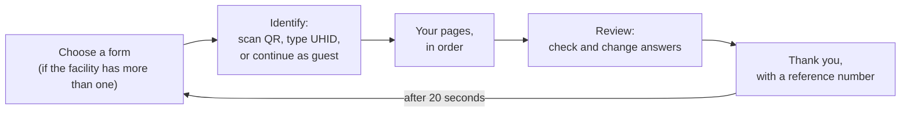

# Making a questionnaire

How to write or change the questions patients answer on the feedback
kiosk: where forms are edited, how their pages and questions are written,
and how the kiosk shows them.

**Contents**

1. [The words used in this guide](#1-the-words-used-in-this-guide)
2. [What the patient sees, start to finish](#2-what-the-patient-sees-start-to-finish)
3. [Where you edit a questionnaire](#3-where-you-edit-a-questionnaire)
4. [Pages and questions, field by field](#4-pages-and-questions-field-by-field)
5. [The four question types](#5-the-four-question-types)
6. [Pages: how they look and behave](#6-pages-how-they-look-and-behave)
7. [Recipes: common changes](#7-recipes-common-changes)
8. [Languages](#8-languages)
9. [Limits and blocked characters](#9-limits-and-blocked-characters)
10. [A complete example](#10-a-complete-example)
11. [Before you go live: a checklist](#11-before-you-go-live-a-checklist)
12. [Error messages and what they mean](#12-error-messages-and-what-they-mean)
13. [What you can't change here](#13-what-you-cant-change-here)

---

## 1. The words used in this guide

| Word | Meaning |
| --- | --- |
| **Kiosk** | The screen in the hospital where patients give feedback: a TV, a tablet or a computer. |
| **Facility id** | The facility's long code, like `2f6c1e8a-4b7d-4c1e-9a3f-5d2e8b7c6a10`. It is the part after `/facility/` in the address bar when you open the facility in Care. |
| **Form** | One questionnaire at one facility, such as "OPD feedback" or "Inpatient feedback". |
| **Code** | A form's short name, such as `opd`. It appears in the kiosk's web address and in the reference number patients get (`OPD-20261124-4821`). |
| **Page** | One part of a form, with its questions. A page of choice, date or text questions is one screen. A page of ratings shows one card per rating. Pages come in the order you list them. |
| **Main button** | The big button at the bottom of a page that moves the patient on, such as "Next". |
| **UHID** | The patient's hospital id, 11 digits, printed on the OP slip. |
| **Guest** | A patient who continues without a UHID. |

---

## 2. What the patient sees, start to finish



1. **Choose a form.** The patient taps the form's title, for example "OPD
   feedback". This page is skipped when the facility has only one active
   form, or when the kiosk is set to open one form directly.
2. **Identify.** The patient scans the QR code on their OP slip, types their
   UHID, or continues as a guest. Every form starts with this page, and you
   can't change it.
3. **Your pages.** This is the part you write: details, rating cards and
   open questions, in the order you list the pages.
4. **Review.** Every answer is listed. The patient can tap any line to change
   it, then taps **Submit feedback**.
5. **Thank you.** The patient sees a reference number. After 20 seconds the
   kiosk goes back to the start for the next patient.

Two buttons appear at the top. **Home**, on every page after the identify
page, leaves the form. **Reset**, from the first rating on, clears the
ratings and later answers. Both ask the patient first. If nobody touches the kiosk for 90 seconds, it
asks whether anyone is still there, then starts over.

---

## 3. Where you edit a questionnaire

1. Open the feedback admin: `https://<care-api-host>/public_forms/admin/`
   and sign in with your Care username and password, plus the code from
   your authenticator app if you turned on two-factor authentication in
   Care. If you can't sign in or can't see **Feedback forms**, ask an
   administrator for staff status and the permissions "Can view feedback
   form" and "Can change feedback form", plus "Can add feedback form" to
   make new forms.
2. Click **Feedback forms**. Each row is one form at one facility.
3. Click a form to edit it, or **Add feedback form** to make a new one.

Each form has these boxes:

| Box | What it is |
| --- | --- |
| **Code** | Short name, lowercase, such as `opd` or `eye_opd`. Don't change it once patients have answered: reports and reference numbers use it. |
| **Patient type** | Outpatient (OP) or inpatient (IP). It picks the icon on the choice page and lets reports filter OP and IP. |
| **Title** (one box per language) | Shown on the choice page and at the top of every page. English is required. |
| **Description** (one box per language) | A line under the title on the choice page. Optional. |
| **Pages** | All the pages and their questions, written in JSON. Most of this guide is about this box. |
| **Facility id** | The facility that offers this form. Required. The facility's name shows below it after saving. |
| **Is active** | Untick to hide the form from patients without deleting it. |
| **Order** | Where the form appears on the choice page: 0 first, then 1, and so on. |
| **Page** | The form's kiosk address. Open it in a browser to try the form. |

When you click **Save**, the admin checks the pages and questions. If
something is wrong, it shows the problem in red and names the page or
question, and nothing is saved until you fix it. See
[section 12](#12-error-messages-and-what-they-mean).

**A new facility has no forms.** Its kiosk shows "No feedback forms are set
up". Either:

- ask a developer to give it the default OPD and inpatient forms
  (`python manage.py seed_feedback_forms`, which gives them to every facility
  that lacks them), and then edit them; or
- open another facility's form, copy everything in its **Pages** box, click
  **Add feedback form**, paste it in, and fill in the other boxes with the
  new facility's id.

**A form that has feedback can't be deleted.** Untick **Is active** instead.

---

## 4. Pages and questions, field by field

The **Pages** box is a list of pages, in the order they are shown. Each page
has its `questions`, in the order they are asked:

```json
[
  {"title": {"en": "About your visit"},
   "questions": [
     {"key": "clinic", "type": "choice", "text": {"en": "Which clinic?"},
      "options": [{"value": "eye", "en": "Eye"}, {"value": "ent", "en": "ENT"}]},
     {"key": "visit_date", "type": "date", "text": {"en": "Date of your visit"}}
   ]},
  {"questions": [
     {"key": "cleanliness", "type": "rating", "text": {"en": "How clean was the hospital?"}}
   ]}
]
```

The quickest way to add a page or a question is to copy one that exists and
change it.

### A page

| Field | Required? | What it does | Example |
| --- | --- | --- | --- |
| `questions` | Yes | The page's questions, in the order they are asked. At least one. | `[ {…}, {…} ]` |
| `title` | No | The page's heading, per language. Without it, the page gets a default heading ([section 6](#6-pages-how-they-look-and-behave)). | `{"en": "About your visit"}` |
| `description` | No | A line under the heading, per language. | `{"en": "Two quick questions."}` |
| `primary_button` | No | The main button's label, per language. Without it, the label follows from what comes next: "Start the questions", "Next" or "Review answers". | `{"en": "Rate our services"}` |

A page of **ratings** takes only `questions`. Each card shows its own
question as the heading, and its button says "Next", or "Review answers" on
the last card of a form that ends with ratings.

### A question

| Field | Required? | What it does | Example |
| --- | --- | --- | --- |
| `key` | Yes | The question's permanent name, where its answers are stored. Lowercase letters, digits and `_`, starting with a letter. Each question in a form needs its own key, across all pages. | `"doctor_explained"` |
| `type` | Yes | `rating`, `choice`, `date` or `text`. See [section 5](#5-the-four-question-types). | `"rating"` |
| `text` | Yes | The question, per language. English is required. | `{"en": "How clean was the ward?", "kn": "…"}` |
| `short_text` | No | A shorter label for the review page. Without it, the review shows `text`. | `{"en": "Ward cleanliness"}` |
| `hint` | No | A smaller line under the question. | `{"en": "Think about the toilets too."}` |
| `options` | Choice: yes. Rating: optional. | Choice: the answers to pick from. Rating: five labels of your own instead of the usual ones. | See [section 5](#5-the-four-question-types). |
| `required` | No (default `false`) | `true`: the patient must answer before moving on. Ratings always need an answer. | `true` |
| `audience` | No (default `"all"`) | Who is asked: `"all"`, `"guest"` (only patients without a UHID) or `"identified"` (only patients who gave a UHID). | `"guest"` |
| `allow_comment` | No (default `false`) | Choices only: adds a "Why? (optional)" box under the answer. | `true` |
| `allow_no_comment` | No (default `true`) | Ratings only: offers "No comments" next to the five faces. `false` removes it. | `false` |
| `active` | No (default `true`) | `false` keeps the question in the form without asking it. | `false` |

A question is asked on the page it is listed in. There is no field for
that: to move a question, move it to another page's `questions`.

> [!IMPORTANT]
> **Never reuse or change a `key` once patients have answered.** Reports
> group answers by key. If you fix a typo in `text`, keep the key, and the
> old and new answers stay together. If a question gets a new meaning, give
> it a new key. Each answer is saved with the wording the patient saw, so
> later edits never change past feedback.

---

## 5. The four question types

Each example below is one question. Put it in a page's `questions` list.

### Rating: a card with faces

Use it for "how good was…" questions. Each rating gets a card of its own:

```text
  Question 3 of 10
  How clean was the hospital?

  (face)      (face)      (face)   (face)   (face)
  Excellent   Very good   Good     Fair     Poor      No comments

  [ Back ]                                             [ Next ]
```

- The counter, "Question 3 of 10", counts the ratings this patient is asked,
  across all pages.
- When the patient taps a face, the kiosk moves to the next card by itself.
- Answers are stored as numbers: Excellent 5, Very good 4, Good 3, Fair 2,
  Poor 1, and No comments 0. "No comments" doesn't count in averages.
- **Your own labels:** give exactly five `options`, from worst to best.
  Each option is text per language, with no `value`:

```json
{"key": "registration_wait", "type": "rating",
 "text": {"en": "Waiting time at the registration counter"},
 "short_text": {"en": "Registration wait"},
 "options": [{"en": "More than 30 mins"}, {"en": "10-30 mins"}, {"en": "5-10 mins"},
             {"en": "Within 5 mins"}, {"en": "Immediate"}]}
```

### Choice: pick one answer

Use it for "which…" questions and yes/no questions. Every option needs a
`value`, a short code that is stored, and its text per language:

```json
{"key": "clinic", "type": "choice", "required": true,
 "text": {"en": "Which clinic did you visit?"},
 "options": [{"value": "general", "en": "General Medicine"},
             {"value": "eye", "en": "Eye"},
             {"value": "ent", "en": "ENT"}]}
```

How it looks depends on where its page is ([section 6](#6-pages-how-they-look-and-behave)):

- **On a page before the ratings:** a row of tappable chips.
  `( General Medicine ) ( Eye ) ( ENT )`
- **On a page after the ratings:** two or three options become large buttons
  side by side, ideal for yes/no. Four or more stay as chips.
  `[    Yes    ]  [    No    ]`

A **yes/no question** is a choice with the options `yes` and `no`. Add
`"allow_comment": true` to ask "Why? (optional)" under it:

```json
{"key": "would_return", "type": "choice", "allow_comment": true,
 "text": {"en": "Would you come back to this hospital?"},
 "options": [{"value": "yes", "en": "Yes"}, {"value": "no", "en": "No"}]}
```

Don't change an option's `value` once patients have answered. It is what
reports count. You can change its text freely.

### Date: pick a day

A date box with a calendar. The date can't be in the future.

```json
{"key": "date_of_admission", "type": "date", "required": true,
 "text": {"en": "Date of admission"}}
```

### Text: type in your own words

A box for free text, up to 2,000 characters. It starts small: one line
before the ratings, two lines after them. As the patient types it grows, up
to eight lines, and then scrolls. The patient can start new lines; the
answer keeps them, and the admin shows them.

```json
{"key": "suggestions", "type": "text",
 "text": {"en": "Any suggestions to improve our services?"}}
```

---

## 6. Pages: how they look and behave

**Rule 1: pages come in the order you list them.** The first page in the
list comes first. To add a page between two others, put it between them in
the list.

**Rule 2: a page holds either ratings or other questions, never both.**

- A page of **ratings** gives one card per rating, one after another.
- A page of **choice, date and text** questions is **one screen** with all of
  them, top to bottom.

**Rule 3: on a page, questions keep their order in its list.** To move a
question up or down on its page, move it up or down in the page's
`questions`.

**Rule 4: a page's look depends on whether it comes before or after the first
rating.**

| | Before the first rating ("details") | After it ("open") |
| --- | --- | --- |
| Default heading | "A few quick details" | "In your own words", then "Last 3 questions. All optional." on the last page, or "A few more questions." on earlier ones |
| Choices | Chips | 2–3 options: large buttons; 4 or more: chips |
| Text boxes | Small | Large |
| Reset button (Home shows on both) | Hidden | Shown |
| Reset | Keeps these answers | Clears these answers |

A form without ratings treats its first page as "details" and the rest as
"open".

**Rule 5: a page can have its own heading.** Give it a `title`, and a
`description` for a line under it. Both are per language. A page without a
title keeps the default heading. Rating pages take neither, because each
card shows its question.

**Rule 6: the main button says where it leads, unless the page names it.**
Without a `primary_button`:

- "Start the questions" leads to the first rating card.
- "Next" leads to another page or card.
- "Review answers" leads to the review.

With `"primary_button": {"en": "Rate our services"}`, the page's button says
that instead. Only the main button can be renamed; Back keeps its label.

When a patient taps an answer on the review page to change it, the main
button always says "Review answers", whatever the page sets, because that is
where it leads. Back is hidden then.

**Rule 7: a page with nothing for this patient is skipped.** For example,
if every question on page 1 has `"audience": "guest"`, patients who gave a
UHID go straight to page 2.

**Rule 8: "optional" is added for you.** On a details page, every question
that isn't `required` shows "· optional". On an open page, it shows only
when the page also has a required question. Otherwise the last page's
heading already says "All optional".

### Putting it together

These pages:

| Page | Questions | Page fields |
| --- | --- | --- |
| 1 | clinic (choice), visit_date (date) | `title` |
| 2 | doctor (rating), cleanliness (rating) | |
| 3 | would_return (choice, yes/no) | |
| 4 | pharmacy (rating) | |
| 5 | suggestions (text) | `primary_button`: "Check my answers" |

give the patient these screens, after the identify page:

1. **Page 1 (details):** its own title; clinic and visit date together, as
   chips and a date box. Button: "Start the questions".
2. **Page 2:** a card for doctor, then a card for cleanliness ("Question 1
   of 3", "Question 2 of 3"). Button on each: "Next".
3. **Page 3 (open):** Yes / No as large buttons. Reset is shown.
   Button: "Next".
4. **Page 4:** a card for pharmacy ("Question 3 of 3"). Button: "Next".
5. **Page 5 (open):** a large box for suggestions. Button: "Check my
   answers" (without `primary_button`, it would say "Review answers").
6. **The review**, then the thank-you page.

---

## 7. Recipes: common changes

| I want to… | Do this |
| --- | --- |
| Add a question to an existing page | Copy a question on that page, give it a new `key` and new `text`, and place it in the page's `questions` where it should appear. |
| Add a new page | Add a `{"questions": [ … ]}` to the list, where it should come. |
| Move a question to another page | Cut it from one page's `questions` and paste it into the other's. Ratings and other questions can't share a page. |
| Reorder pages | Move the pages up or down in the list. |
| Reorder questions on a page | Move them up or down in the page's `questions`. |
| Make a question compulsory | `"required": true`. |
| Ask only guests, for example age and sex | `"audience": "guest"`. |
| Ask only patients who gave a UHID | `"audience": "identified"`. |
| Stop asking a question for now | `"active": false`. Its past answers stay in reports. |
| Remove a question for good | Delete it from its page. Past answers are kept, with the wording patients saw. A page left with no questions must go too. |
| Reword a question | Change `text`, and keep the `key`. |
| Ask a question with a new meaning | Give it a new `key`. |
| Add "Why?" under a yes/no | `"allow_comment": true`. |
| Remove "No comments" from a rating | `"allow_no_comment": false`. |
| Use labels like "Immediate … More than 30 mins" on a rating | Give five `options`, worst first (see [section 5](#5-the-four-question-types)). |
| Change a page's heading | Give the page a `title`, and a `description` if you like. |
| Change the main button's label | Give the page a `primary_button`. |
| Show a shorter label on the review | `"short_text": {"en": "…"}`. |
| Hide a whole form | Untick **Is active**. |
| Change the order of forms on the choice page | Change each form's **Order**. |

---

## 8. Languages

Every piece of text is written per language, with the language's code as the
name:

```json
"text": {"en": "How clean was the hospital?", "kn": "ಆಸ್ಪತ್ರೆ ಎಷ್ಟು ಸ್ವಚ್ಛವಾಗಿತ್ತು?"}
```

- `"en"` (English) is always required.
- The kiosk offers the languages it is set up with, currently English (`en`)
  and Kannada (`kn`). The patient switches with the button in the header.
- Text missing in a language shows in English, so a half-translated form
  still works. This includes a page's `title`, `description` and
  `primary_button`.
- Options carry their languages next to their value:
  `{"value": "eye", "en": "Eye", "kn": "ಕಣ್ಣು"}`.
- The form's title and description have one box per language in the admin.
- Have a native speaker check every translation before patients see it.

---

## 9. Limits and blocked characters

| What | Most characters |
| --- | --- |
| Form title, page `title` | 100 |
| Form description, page `description` | 300 |
| Page `primary_button` | 40 |
| Question `text` and `hint` | 300 |
| `short_text` | 60 |
| An option's text | 100 |
| An option's `value` | 64 |
| A patient's typed answer | 2,000 |

These limits apply to each language separately. A form can have up to 99
pages.

These characters are refused everywhere, in your questions and in what
patients type, because they can be used to attack web pages:
`<` `>` `{` `}` `` ` `` `\`

Write "less than 5 minutes" instead of "< 5 mins".

---

## 10. A complete example

A short eye-clinic form with every feature in this guide. You can paste it
into the **Pages** box and adapt it:

```json
[
  {"title": {"en": "About your visit"},
   "questions": [
     {"key": "visit_type", "type": "choice", "required": true,
      "text": {"en": "What was your visit for?"},
      "options": [{"value": "new", "en": "First visit"},
                  {"value": "follow_up", "en": "Follow-up"},
                  {"value": "surgery", "en": "Surgery"}]},
     {"key": "age_group", "type": "choice", "required": true, "audience": "guest",
      "text": {"en": "Your age group"},
      "options": [{"value": "under_18", "en": "Under 18"}, {"value": "18_45", "en": "18-45"},
                  {"value": "46_60", "en": "46-60"}, {"value": "over_60", "en": "Over 60"}]}
   ]},

  {"questions": [
     {"key": "waiting_time", "type": "rating",
      "text": {"en": "How long did you wait to see the doctor?"},
      "short_text": {"en": "Waiting time"},
      "options": [{"en": "More than 1 hour"}, {"en": "30-60 mins"}, {"en": "15-30 mins"},
                  {"en": "Within 15 mins"}, {"en": "Immediate"}]},
     {"key": "doctor_explained", "type": "rating",
      "text": {"en": "How well did the doctor explain your condition?"},
      "short_text": {"en": "Doctor's explanation"},
      "hint": {"en": "Including the medicines and the next visit."}},
     {"key": "clean_clinic", "type": "rating", "allow_no_comment": false,
      "text": {"en": "How clean was the clinic?"},
      "short_text": {"en": "Cleanliness"}}
   ]},

  {"title": {"en": "One last thing"},
   "description": {"en": "Your answers help us improve."},
   "primary_button": {"en": "Check my answers"},
   "questions": [
     {"key": "would_recommend", "type": "choice", "required": true, "allow_comment": true,
      "text": {"en": "Would you recommend this clinic to a friend?"},
      "options": [{"value": "yes", "en": "Yes"}, {"value": "no", "en": "No"}]},
     {"key": "suggestions", "type": "text",
      "text": {"en": "Anything we could do better?"}}
   ]}
]
```

The patient sees:

1. **About your visit:** what the visit was for, as chips. Guests also get
   their age group, and patients with a UHID don't. Button: "Start the
   questions".
2. **Three rating cards:** waiting time with the custom labels, the doctor's
   explanation with its hint, and cleanliness without "No comments".
3. **One last thing:** Yes / No as large buttons with a "Why?" box, and a
   large suggestions box. Button: "Check my answers".
4. **The review:** "Waiting time", "Doctor's explanation" and so on, using
   the `short_text` labels.

---

## 11. Before you go live: a checklist

- [ ] The form saved without errors.
- [ ] **Facility id** is the right facility, and **Is active** is ticked.
- [ ] Every question has English text, and any other language a native
      speaker has checked.
- [ ] No `key` or option `value` that patients have already answered was
      changed.
- [ ] Open the **Page** link in a browser and go through the form twice: as
      a guest, and with a UHID. Read every page.
- [ ] Try the review: tap an answer, change it, and come back.
- [ ] Stop at the review unless you mean to submit. A submitted test counts
      as real feedback in that facility's reports.
- [ ] Look at it on the kiosk itself, or a screen of the same size: long
      questions wrap, a page with many questions scrolls, and a long button
      label fits.

---

## 12. Error messages and what they mean

The admin names the page ("Page 2") or the question (by its `key`, or by its
place, "Page 2, question 3", if it has no key) in every message.

| Message (shortened) | What to fix |
| --- | --- |
| Enter a valid JSON | The **Pages** box isn't valid JSON. Check the commas, quotes and brackets near your last change. |
| The pages must be a list | The whole box must be one `[ … ]` of pages. |
| Page N: looks like a question. Questions go inside pages | The box holds questions directly. Put them in pages: `[ {"questions": [ … ]} ]`. |
| Page N: must be an object | Each page is a `{ … }` with its `questions`. |
| Page N: questions must be a list of at least one question | The page has no `questions`, or an empty list. Add a question, or remove the page. |
| Page N: unknown field(s) … | A page field is misspelt, for example `titel`. The message lists the allowed names. |
| Page N: has ratings, which get a card each; move its … questions to a page of their own | A choice, date or text question is on a page with ratings. Move it to another page. |
| Page N: has ratings … it takes no title | A page of ratings has a `title`, `description` or `primary_button`. Remove it. |
| Page N: title needs English text | Add `"en": "…"` inside the page's `title` (or `description`, or `primary_button`). |
| key must be lowercase letters, digits and _ | Use only `a-z`, `0-9` and `_`, starting with a letter: `doctor_2`, not `Doctor 2`. |
| another question already uses this key | Two questions share a key, maybe on different pages. Rename one. |
| type must be one of choice, date, rating, text | Check the spelling of `type`. |
| text needs the English question | Add `"en": "…"` inside `text`. |
| unknown field(s) … | A question field is misspelt, for example `requird`. The message lists the allowed names. |
| step isn't used any more | A question has a `step`, from the old format. Remove it: the question is asked on the page it's listed in. |
| a choice needs options | Add `options` to the choice. |
| every option needs a value | Each choice option needs `"value": "…"`. |
| option values must be unique | Two options of one question share a value. |
| give exactly five labels … Poor → Excellent, or none | A rating's `options` must be exactly five, or left out. |
| a date question has no options / a text question has no options | Remove `options` from that question. |
| allow_comment ("Why?") is for choices only | Remove `allow_comment` from a non-choice question. |
| … can't contain < > | Remove the blocked characters ([section 9](#9-limits-and-blocked-characters)). |
| … is longer than N characters | Shorten the text ([section 9](#9-limits-and-blocked-characters)). |
| A form can have at most 99 pages | Combine some pages. |
| This facility already has a form with this code | Pick another code, or edit the existing form. |
| No facility has this id | The facility id is wrong. Copy it again from Care. |

---

## 13. What you can't change here

Some parts of the kiosk are the same for every form. To change them, ask a
developer:

- the identify page (scan, UHID or guest), the review page and the thank-you
  page;
- the fixed wording, such as Back, Submit feedback, the default main-button
  labels and headings, and the rating words Excellent to Poor (these live in
  the language files). A page can still name its own main button and
  heading ([section 6](#6-pages-how-they-look-and-behave));
- the 11-digit UHID length, the idle reset times and the 20-second
  thank-you page;
- the languages offered, the colours and the fonts.

For how the system works underneath, see [architecture.md](architecture.md).
For setup and settings, see the [README](../README.md).
